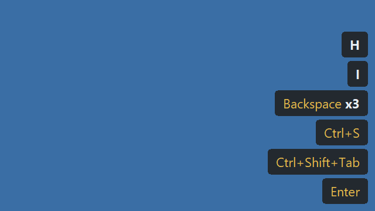
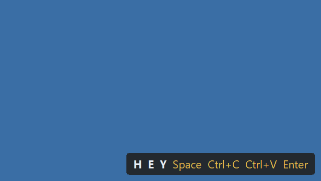
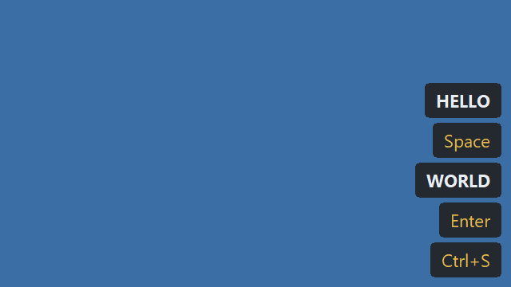

# keypop

[](https://github.com/learn-more/keypop/actions/workflows/build.yml) [](https://spdx.org/licenses/MIT)  

Shows pressed keys and mouse buttons as an overlay in the bottom right corner of the screen. Meant for screencasts and demos.

See https://learn-more.github.io/keypop/ for an overview of the features.

Runs from the tray. Right-click it to pick a display mode (stacked toasts, rolling line or words), pause, or exit. The chosen mode is saved to `keypop.ini` next to the exe.

## Modes

Stacked toasts: one toast per key, repeats are counted.



Rolling line: everything on a single line.



Words: typed characters share a toast, special keys get their own.



## Requirements

Runs on Windows 7 and later. Built without the CRT, so it's a single small exe with no runtime dependencies.

## Building

Needs MSVC and CMake. Use `-A Win32` for an x86 build.

```
cmake -B build -A x64
cmake --build build --config Release
```

`src/res/app.ico` is generated by `scripts/make_icon.py` (`uv run --with pillow scripts/make_icon.py`).

## License

MIT, see [LICENSE](LICENSE).
