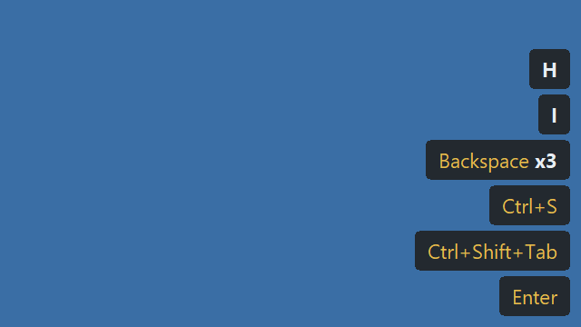
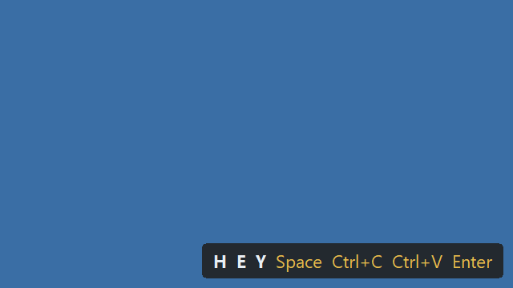
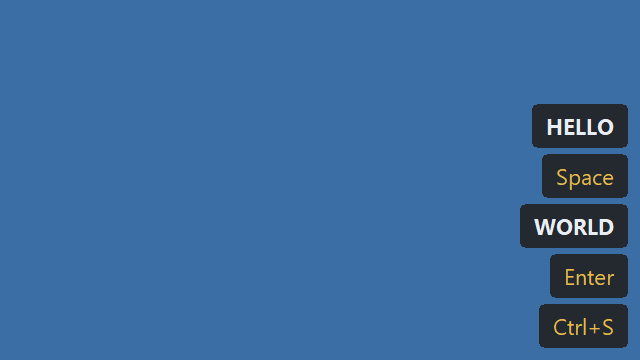

# keypop

## Why keypop?
When recording a screencast or giving a demo, viewers cannot see what is being typed or clicked.
keypop shows pressed keys and mouse buttons as an overlay in the bottom right corner of the screen.

## Features

* Shows pressed keys and mouse buttons as an overlay
* Three display modes:
    * Stacked toasts: one toast per key, repeats are counted
    * Rolling line: everything on a single line
    * Words: typed characters share a toast, special keys get their own
* Runs from the tray, right-click to pick a display mode, pause or exit
* The chosen mode is saved to `keypop.ini` next to the exe
* A single small exe with no runtime dependencies (built without the CRT)
* Works on Windows 7 and newer

## Screenshots

Stacked toasts:

Rolling line:

Words:

